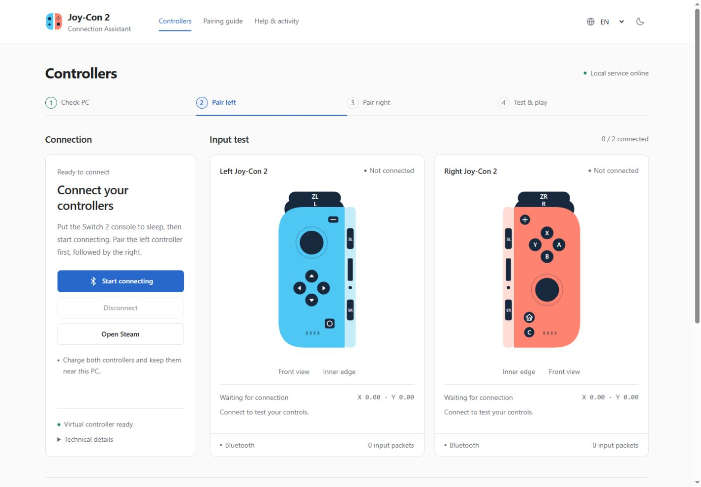
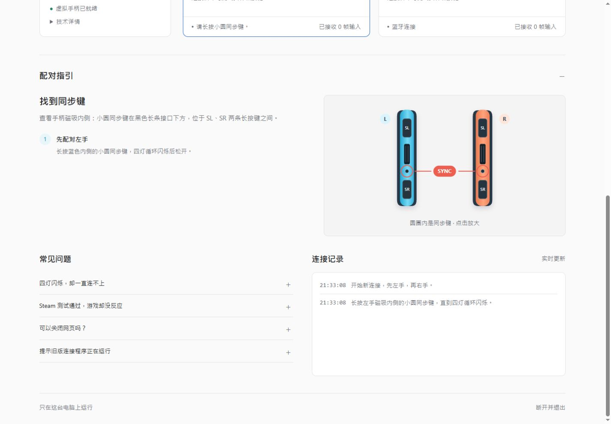
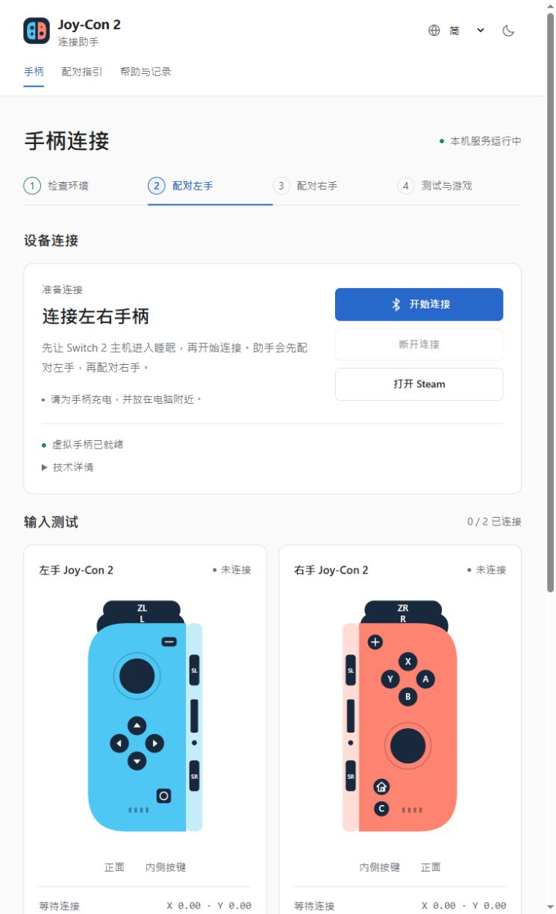

<p align="center">
  
</p>
<h1 align="center">Joy-Con 2 Connect for Windows</h1>
<p align="center">
  Connect your Joy-Con 2. See every input. Start playing.<br>
  连接左右 Joy-Con 2，实时测试按键和摇杆，开始电脑游戏。
</p>
<p align="center">
  <strong>Windows x64 · Local &amp; offline · EN / 繁 / 简</strong><br><br>
  <a href="https://github.com/wuqian-tang/joycon2-connect-windows/releases/latest">Download / 下载</a> ·
  <a href="#english">English guide</a> ·
  <a href="#简体中文">中文指南</a> ·
  <a href="docs/ARCHITECTURE.md">Project layout / 项目结构</a>
</p>



| Pair step by step / 分步连接                                       | See your input / 实时反馈                                                                      | Keep it local / 本地使用                                                  |
| ------------------------------------------------------------------ | ---------------------------------------------------------------------------------------------- | ------------------------------------------------------------------------- |
| Environment → left → right → test<br>检查环境 → 左手 → 右手 → 测试 | Two controller diagrams, button highlights and moving sticks<br>双手柄图示、按键高亮和摇杆位置 | No account, no cloud, bundled runtime<br>无需账号、无需云端、自带运行环境 |

<details>
<summary>More light-mode screenshots / 更多明亮模式截图</summary>

**Pairing guide / 配对引导**



**Narrow window / 窄窗口**



</details>

## English

### Features

- Guided left-then-right Bluetooth pairing, with connection status and troubleshooting.
- Live controller drawings show received button presses and stick positions.
- Centered responsive interface with system-initialized appearance, a sun/moon switch, and subtle transitions that respect reduced-motion preferences.
- Compact globe language selector: **EN / 繁 / 简**. The initial selection follows the system language; unsupported languages fall back to English. Manual language and theme choices are remembered in this browser.
- Windows x64 installer and portable ZIP, both including the runtime. First-run setup checks the vJoy driver and guides you through any missing prerequisite.
- Original flat controller icon for the app and desktop shortcut.

### Requirements

- Windows 10 or 11, **x64**; a Bluetooth Low Energy adapter and two Joy-Con 2 controllers.
- [Official Brunner vJoy 2.2.2.0 driver](https://github.com/BrunnerInnovation/vJoy/releases/tag/v2.2.2.0). Configure device **1** with **at least 24 buttons** and the **X, Y, Rx, Ry** axes. Restart if the installer requests it.
- A browser. Steam is optional; this tool presents a DirectInput vJoy device, not an Xbox/XInput controller.

The initial hardware test used Windows 10 and vJoy 2.2.2.0. Other Bluetooth adapters and Windows installations may behave differently. Windows ARM, original Joy-Con and Switch 2 Pro Controller are outside this release's tested scope.

### Download and use

1. Download **`JoyCon2Connect-1.1.0-Setup.exe`** from [Releases](https://github.com/wuqian-tang/joycon2-connect-windows/releases/latest). Run it, choose a folder, and keep the desktop shortcut selected. No Python or terminal is needed.
2. Open the app. The browser checks your PC first. If vJoy is missing, click **Install vJoy** to download and verify the official installer, finish its Windows wizard, then click **Recheck**. Restart if requested. If device 1 needs configuration, the app offers that step separately. Existing ready drivers are kept.
3. Put the Switch 2 to sleep. Click **Start connecting** and hold the **left** controller's small round SYNC button until its four lights cycle, then release it. The guide shows the exact button location.
4. When prompted, do the same for the **right** controller.
5. Move both sticks and press buttons to verify the live drawings. Open Steam and start your game **after** connecting. If necessary, enable Steam Input in the game's Properties → Controller.

**Prefer a portable folder?** Download the Windows x64 ZIP instead. Extract the **whole folder** somewhere writable, such as `D:\Apps\JoyCon2Connect`, and run `JoyCon2Assistant.exe`. Keep both EXEs and `_internal` together. It uses the same first-run guide. The local page is `http://127.0.0.1:19862`.

Optional desktop shortcut: right-click `scripts/create-shortcut.ps1` → **Run with PowerShell**. It points to the extracted EXE and uses its flat Joy-Con icon. Moving the app folder later requires recreating the shortcut.

Closing the browser tab keeps the connection service running. Use **Disconnect** to release the controllers, or the app's **Exit** action to stop the local service. Reopening the app reuses the running service.

### Troubleshooting

- **No vJoy driver / version mismatch:** install the official 2.2.2.0 driver and restart; check device 1's axes/buttons. The bundled SDK DLL does not install a system driver.
- **Controller not found:** turn Bluetooth on, keep the controller near the PC and the console asleep, then use SYNC again. Connect one side at a time. Cycling player LEDs indicate pairing; pressing a normal button may instead reconnect to the console.
- **Works in Steam's test, not a game:** enable Steam Input in that game's Properties → Controller, connect first, then restart the game through Steam. This tool cannot guarantee compatibility with every game.
- **Connection interrupted:** disconnect and retry; avoid running Joy2Win or another Bluetooth controller bridge at the same time.
- **Blank/unreachable browser page:** rerun the EXE; check whether port 19862 is occupied. The app listens on loopback only.

The app and its setup EXE are unsigned. The separately downloaded vJoy installer is verified by its fixed SHA-256 and Windows signature before opening. Driver installation/configuration happens only when you select its setup action, and Windows may request administrator permission. This tool does not disable Windows security features.

### Privacy and architecture

The browser talks to a local Python HTTP service; a separate worker forwards Bluetooth input to vJoy. Normal use is offline and needs no analytics, account or cloud server. Only the optional first-run driver download needs internet access; it fetches the fixed official GitHub release when you select Install. Steam/driver links open their respective external services when selected.

Runtime data is kept in `runtime` beside the app; a read-only folder falls back to `%LOCALAPPDATA%\JoyCon2Assistant\runtime`. Bluetooth addresses are redacted from normal logs. Do not publish your runtime folder. The service binds to `127.0.0.1`, validates Host/Origin and uses a per-run request token for actions.

### Run from source / build

Use Windows x64 with Python **3.10** and PowerShell. The pinned dependencies were verified with Python 3.10.6.

```powershell
python -m venv .venv
.\.venv\Scripts\python.exe -m pip install -r requirements-build.txt
.\.venv\Scripts\python.exe launcher.py
```

Build and verify both EXEs and the ZIP:

```powershell
.\scripts\build-portable.ps1 -Python .\.venv\Scripts\python.exe
```

To also build the installer, install the official Inno Setup compiler and run `scripts/build-setup.ps1 -SkipPortableBuild`. The GitHub Windows release workflow uses the compiler already provided by the runner. Both downloads include SHA-256 checksums.

The script runs Python tests, builds with PyInstaller, checks a real packaged service on a separate port and passively scans Bluetooth without pairing. Output: `dist/JoyCon2Assistant` and `releases/JoyCon2Assistant-1.1.0-windows-x64.zip`, with a SHA-256 checksum. Driver installation and real controller pairing remain separate checks.

Additional frontend locale checks, with Node.js installed:

```powershell
node --test tests/test_i18n.cjs
```

The UI is plain HTML/CSS/JavaScript; no npm build or CDN is required. Rebuild the icon with `python scripts/make_icon.py` after installing the build requirements. Application code and web assets live in `joycon2_assistant`; root `launcher.py`, `app.py` and `worker_entry.py` are thin entry points. Vendored hardware support lives in `vendor`. See [project layout](docs/ARCHITECTURE.md) and [contributing](CONTRIBUTING.md).

### License and acknowledgements

Original app code and illustrations: [MIT](LICENSE). Joy2Win's pinned MIT source, the vJoy SDK and other dependencies retain their licenses. See [NOTICE.md](NOTICE.md) and `licenses` for full notices, including the LGPL pynput source and replacement/rebuild instructions. Keep the notices when redistributing.

This is an independent community tool, unaffiliated with Nintendo, Microsoft or Valve. Product names belong to their respective owners.

## 简体中文

这是一个在 Windows 上连接 Nintendo Switch 2 左右 Joy-Con 2 的本地工具，通过 vJoy 输出虚拟手柄，并提供离线网页界面。

### 功能

- 引导先连接左手、再连接右手，显示连接状态和排查提示。
- 两只手柄的实时图示，显示实际收到的按键和摇杆位置。
- 居中自适应布局，初始主题跟随系统；太阳、月亮按钮可切换明暗，轻量动画尊重系统减少动态效果设置。
- 地球图标旁可选择 **EN / 繁 / 简**；初始语言跟随系统，不支持的系统语言显示英文。手动语言和主题选择会保存在当前浏览器。
- Windows x64 安装包和便携版均自带运行环境；首次打开会检查 vJoy 并引导处理缺失的依赖。
- 程序和桌面快捷方式使用原创的扁平双 JC 图标。

### 使用条件

- Windows 10 / 11 **64 位**、支持低功耗蓝牙的适配器，以及一对 Joy-Con 2。
- 安装 [Brunner 官方 vJoy 2.2.2.0 驱动](https://github.com/BrunnerInnovation/vJoy/releases/tag/v2.2.2.0)，将设备 **1** 配置为**至少 24 个按钮**，启用 **X、Y、Rx、Ry** 轴；安装程序要求时重启电脑。
- 一个浏览器。Steam 为可选项；本工具输出的是 DirectInput vJoy 设备。

初始实机测试使用 Windows 10 和 vJoy 2.2.2.0。不同蓝牙适配器和 Windows 环境可能表现不同。本版本未验证 Windows ARM、第一代 Joy-Con 或 Switch 2 Pro 手柄。

### 下载和使用

1. 在 [Releases](https://github.com/wuqian-tang/joycon2-connect-windows/releases/latest) 下载 **`JoyCon2Connect-1.1.0-Setup.exe`**。双击安装、选择目录，并保留桌面快捷方式选项；无需安装 Python 或使用终端。
2. 打开助手，网页会先检查电脑环境。缺少 vJoy 时，点击**安装 vJoy**，助手下载并验证官方安装包，再打开 Windows 安装向导。完成后点击**重新检查**，按需重启。设备 1 配置不完整时，会单独提供配置步骤；已就绪的驱动会保留。
3. 让 Switch 2 保持睡眠，点击**开始连接**。先长按**左手**磁吸内侧的小圆 SYNC 同步键，四灯循环闪烁后松开。网页有位置示意图。
4. 网页提示连接**右手**后，再对右手重复相同操作。
5. 移动两边摇杆并按键，检查实时反馈。**连接成功后再通过 Steam 启动游戏**；需要时在游戏属性 → 控制器中启用 Steam Input。

**想使用免安装便携版？** 下载 Windows x64 ZIP，完整解压到可写目录，例如 `D:\Apps\JoyCon2Connect`，再运行 `JoyCon2Assistant.exe`。两个 EXE 和 `_internal` 文件夹必须保留在一起，首次环境引导与安装版相同。网页地址是 `http://127.0.0.1:19862`。

需要桌面快捷方式时，右键 `scripts/create-shortcut.ps1`，选择“使用 PowerShell 运行”。快捷方式使用程序的扁平 JC 图标；以后移动程序文件夹，需要重新创建快捷方式。

关闭网页不会停止连接。点击“断开连接”可释放手柄；使用网页内“退出助手”可关闭本地服务。再次启动程序会复用已有服务。

### 常见问题

- **缺少 vJoy / 版本不匹配：**安装官方 2.2.2.0 驱动，重启并检查设备 1 的轴和按钮配置。随程序附带的 SDK DLL 不能替代系统驱动。
- **找不到手柄：**打开蓝牙、让主机保持睡眠，将手柄放到电脑附近，重新按 SYNC，一次只连接一只。普通按键可能让手柄回连主机。
- **Steam 测试正常、游戏没反应：**在游戏属性 → 控制器中启用 Steam Input，先连接，再通过 Steam 重启游戏。本工具无法保证兼容所有游戏。
- **连接中断：**断开后重试，避免同时运行 Joy2Win 或其他手柄蓝牙桥接程序。
- **网页打不开：**重新运行 EXE，检查 19862 端口是否被占用；网页服务只监听本机回环地址。

本工具与安装包 EXE 尚未进行代码签名。官方 vJoy 安装包打开前会校验固定 SHA-256 和 Windows 签名。只有点击对应设置按钮，才会安装驱动或配置设备，Windows 可能请求管理员权限。工具不会关闭 Windows 安全功能。

### 隐私和结构

网页访问本机 Python HTTP 服务，由独立工作进程接收蓝牙输入并传给 vJoy。正常使用离线可用，无需账号、云服务器或统计服务。只有首次点击安装驱动时需要联网，从固定的 GitHub 官方发布地址下载安装包；点击 Steam 或驱动链接会打开对应外部服务。

运行数据默认保存在程序旁的 `runtime`，目录只读时使用 `%LOCALAPPDATA%\JoyCon2Assistant\runtime`。正常日志会隐藏蓝牙地址；请勿公开自己的 runtime 文件夹。服务绑定 `127.0.0.1`，校验 Host/Origin，并为操作请求使用每次启动生成的令牌。

### 源码运行和构建

使用 Windows x64、Python **3.10** 和 PowerShell；依赖已在 Python 3.10.6 验证。

```powershell
python -m venv .venv
.\.venv\Scripts\python.exe -m pip install -r requirements-build.txt
.\.venv\Scripts\python.exe launcher.py
.\scripts\build-portable.ps1 -Python .\.venv\Scripts\python.exe
```

构建脚本运行 Python 测试，通过 PyInstaller 生成两个 EXE，并在独立端口验证真实便携服务、进行不配对的被动蓝牙扫描。输出目录为 `dist/JoyCon2Assistant`，ZIP 和 SHA-256 校验文件位于 `releases`。驱动安装和真实手柄配对需另外验证。

需要构建安装包时，安装官方 Inno Setup 编译器，再运行 `scripts/build-setup.ps1 -SkipPortableBuild`。GitHub Windows 发布流程使用 runner 预装的编译器。安装包和便携包都提供 SHA-256 校验文件。

安装 Node.js 后可运行语言与主题偏好测试：`node --test tests/test_i18n.cjs`。前端为原生 HTML/CSS/JavaScript，无需 npm 构建或 CDN。安装构建依赖后，可用 `python scripts/make_icon.py` 重建图标。源码和网页资源统一放在 `joycon2_assistant`；根目录的 `launcher.py`、`app.py` 和 `worker_entry.py` 只作为薄入口。第三方硬件支持源码位于 `vendor`。详见[项目结构](docs/ARCHITECTURE.md)与[贡献说明](CONTRIBUTING.md)。

### 许可证和致谢

原创程序与图示采用 [MIT 许可证](LICENSE)。Joy2Win 固定版本的 MIT 源码、vJoy SDK 及其他依赖保留各自许可证。详见 [NOTICE.md](NOTICE.md) 和 `licenses`，包括 LGPL pynput 源码及替换、重建说明。再分发时请保留相关声明。

本项目为社区独立工具，与 Nintendo、Microsoft、Valve 无关联。产品名称归各自权利人所有。
