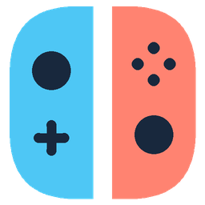

<h1 align="center">Joy-Con 2 Connect for Windows</h1>

<a href="#english">English</a> · <a href="#简体中文">简体中文</a>

## English

Connect your Switch 2 Joy-Con pair to Windows.

Requires 64-bit Windows 10/11 and Bluetooth.

### Get started

1. [Download the installer](https://github.com/wuqian-tang/joycon2-connect-windows/releases/download/v1.1.2/JoyCon2Connect-1.1.2-Setup.exe), install and open the app.
2. Complete the driver setup if prompted.
3. Put the Switch 2 to sleep, then follow the app to connect the left and right controllers.
4. Test the controls, then launch your game through Steam.

If a game does not respond, enable Steam Input for that game and restart it after connecting.

[Portable ZIP](https://github.com/wuqian-tang/joycon2-connect-windows/releases/download/v1.1.2/JoyCon2Assistant-1.1.2-windows-x64.zip) · [Help](https://github.com/wuqian-tang/joycon2-connect-windows/issues) · [Developer guide](joycon2_assistant/README.md)

## 简体中文

将 Switch 2 的左右 Joy-Con 2 连接到 Windows。

需要 64 位 Windows 10/11 和蓝牙。

### 开始使用

1. [下载安装包](https://github.com/wuqian-tang/joycon2-connect-windows/releases/download/v1.1.2/JoyCon2Connect-1.1.2-Setup.exe)，安装并打开助手。
2. 如提示缺少驱动，按页面引导完成设置。
3. 让 Switch 2 主机进入睡眠，按网页提示依次连接左手和右手。
4. 测试摇杆和按键，然后通过 Steam 启动游戏。

如果游戏没反应，在该游戏的控制器设置中启用 Steam Input，连接后重启游戏。

[便携版](https://github.com/wuqian-tang/joycon2-connect-windows/releases/download/v1.1.2/JoyCon2Assistant-1.1.2-windows-x64.zip) · [反馈问题](https://github.com/wuqian-tang/joycon2-connect-windows/issues) · [开发说明](joycon2_assistant/README.md)
